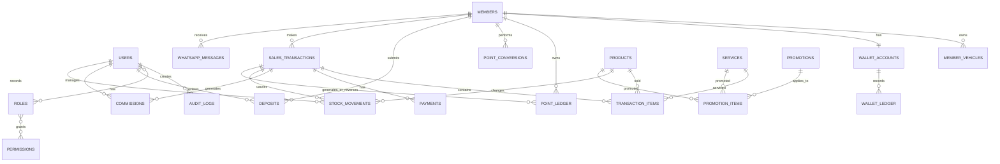

# 06 — DATABASE ERD
## Bengkel POS — Syuhada Motor

**Versi:** 1.0  
**Status:** Draft ERD / Database Specification  
**Timezone:** Asia/Jakarta

> Dokumen ini menjadi dasar rancangan database Bengkel POS Syuhada. Nilai bisnis yang belum ditetapkan tidak boleh di-hard-code.

---

## 1. Prinsip Database

1. Perubahan saldo dan point selalu melalui ledger.
2. Histori finansial tidak dihapus.
3. Aktivitas sensitif dicatat pada audit log.
4. Harga transaksi disimpan sebagai snapshot.
5. Operasi finansial harus idempotent agar tidak terjadi double credit/debit.
6. Operasi kritis menggunakan database transaction.
7. Nominal uang tidak menggunakan floating point.
8. Primary key disarankan UUID/ULID.
9. Member dan kendaraan dipisahkan agar satu member dapat memiliki beberapa kendaraan.
10. `current_balance`/`current_points` hanya cache/balance cepat; histori tetap berasal dari ledger.

---

## 2. Gambaran Entitas

```text
USERS
 ├── ROLES ─── PERMISSIONS
 └── AUDIT_LOGS

MEMBERS
 ├── MEMBER_VEHICLES
 ├── WALLET_ACCOUNTS ─── WALLET_LEDGER
 ├── POINT_LEDGER
 ├── POINT_CONVERSIONS
 ├── DEPOSITS
 ├── WHATSAPP_MESSAGES
 └── SALES_TRANSACTIONS
          ├── TRANSACTION_ITEMS
          │      ├── PRODUCTS
          │      └── SERVICES
          ├── PAYMENTS
          ├── STOCK_MOVEMENTS
          ├── POINT_LEDGER
          └── COMMISSIONS

PROMOTIONS ─── PROMOTION_ITEMS
```

---

## 3. ERD Konseptual



---

# 4. Struktur Tabel

## 4.1 `users`

Akun internal aplikasi.

| Field | Keterangan |
|---|---|
| id | PK UUID/ULID |
| name | Nama |
| email | Email, nullable |
| phone | Nomor HP |
| password_hash | Hash password |
| status | active/inactive |
| last_login_at | Login terakhir |
| created_at | |
| updated_at | |

---

## 4.2 `roles`

| Field | Keterangan |
|---|---|
| id | PK |
| name | Nama role |
| description | Deskripsi |
| status | active/inactive |

Role awal:

```text
SUPER_ADMIN
ADMIN
KASIR
PEGAWAI
```

---

## 4.3 `permissions`

Contoh permission:

```text
member.view
member.update
product.view
product.create
product.update
stock.view
stock.adjust
transaction.create
transaction.cancel
deposit.view
deposit.approve
deposit.reject
wallet.view
wallet.adjust
point.view
point.adjust
promotion.manage
employee.manage
report.view
audit.view
```

---

## 4.4 `role_permissions`

Relasi many-to-many:

```text
roles ↔ permissions
```

---

## 4.5 `members`

Data member.

| Field | Keterangan |
|---|---|
| id | PK |
| whatsapp | UNIQUE |
| owner_name | Nama pemilik |
| gender | Jenis kelamin |
| birth_day | 1–31 |
| birth_month | 1–12 |
| profile_completed | Boolean |
| status | active/inactive/blocked |
| registered_at | |
| created_at | |
| updated_at | |

**Tahun lahir tidak disimpan**, sesuai business rule saat ini.

---

## 4.6 `member_vehicles`

| Field | Keterangan |
|---|---|
| id | PK |
| member_id | FK → members |
| plate_number | Nomor plat |
| vehicle_type | Jenis kendaraan |
| brand | Merek |
| model | Model |
| color | Nullable |
| year | Nullable |
| status | active/inactive |
| created_at | |
| updated_at | |

Index:

```text
member_id
plate_number
```

---

## 4.7 `product_categories`

| Field | Keterangan |
|---|---|
| id | PK |
| name | Nama |
| description | Deskripsi |
| status | active/inactive |

---

## 4.8 `products`

| Field | Keterangan |
|---|---|
| id | PK |
| sku | UNIQUE |
| category_id | FK |
| name | Nama |
| unit | Satuan |
| purchase_price | Harga beli |
| selling_price | Harga jual |
| stock_qty | Stok/cache |
| minimum_stock | Minimum stok |
| status | active/inactive |
| created_at | |
| updated_at | |

Histori stok berada di `stock_movements`.

---

## 4.9 `service_categories`

| Field | Keterangan |
|---|---|
| id | PK |
| name | Nama |
| description | Deskripsi |
| status | active/inactive |

---

## 4.10 `services`

| Field | Keterangan |
|---|---|
| id | PK |
| code | UNIQUE |
| category_id | FK |
| name | Nama |
| price | Harga |
| estimated_minutes | Estimasi |
| status | active/inactive |
| created_at | |
| updated_at | |

---

## 4.11 `employees`

| Field | Keterangan |
|---|---|
| id | PK |
| user_id | FK nullable |
| name | Nama |
| whatsapp | Nomor WA |
| role_name | Peran |
| commission_type | percentage/fixed |
| commission_value | Nilai |
| status | active/inactive |
| created_at | |
| updated_at | |

---

# 5. Transaksi POS

## 5.1 `sales_transactions`

| Field | Keterangan |
|---|---|
| id | PK |
| transaction_number | UNIQUE |
| member_id | FK nullable |
| vehicle_id | FK nullable |
| cashier_user_id | FK → users |
| transaction_at | Waktu |
| subtotal | Sebelum diskon |
| discount_amount | Total diskon |
| total_amount | Setelah diskon |
| promo_id | FK nullable |
| payment_status | unpaid/partial/paid/refunded |
| transaction_status | draft/completed/cancelled/refunded |
| notes | Catatan |
| created_at | |
| updated_at | |

---

## 5.2 `transaction_items`

| Field | Keterangan |
|---|---|
| id | PK |
| transaction_id | FK |
| item_type | product/service |
| product_id | FK nullable |
| service_id | FK nullable |
| item_name_snapshot | Nama saat transaksi |
| qty | Jumlah |
| unit_price | Harga saat transaksi |
| discount_percent | Diskon |
| discount_amount | Nilai diskon |
| final_unit_price | Harga setelah diskon |
| subtotal | Total |
| employee_id | FK nullable |
| created_at | |

**Snapshot wajib** agar transaksi lama tidak berubah ketika harga master berubah.

---

## 5.3 `payments`

| Field | Keterangan |
|---|---|
| id | PK |
| transaction_id | FK |
| payment_method | cash/wallet/other |
| amount | Nominal |
| wallet_ledger_id | FK nullable |
| payment_at | |
| status | completed/reversed |
| reference | Referensi |
| created_by | FK |
| created_at | |

Jika memakai saldo:

```text
payment_method = wallet
wallet_ledger_id = ledger DEBIT
```

---

# 6. Promo

## 6.1 `promotions`

| Field | Keterangan |
|---|---|
| id | PK |
| name | Nama promo |
| type | percentage/fixed |
| value | Nilai |
| start_at | Mulai |
| end_at | Berakhir |
| scope | product/service/both |
| member_only | Boolean |
| max_discount | Nullable |
| status | draft/active/inactive/expired |
| created_by | FK |
| created_at | |
| updated_at | |

Promo Grand Opening:

```text
name  = Grand Opening Syuhada Motor
type  = percentage
value = 15
scope = both
```

Tanggal aktual diisi admin.

## 6.2 `promotion_items`

| Field | Keterangan |
|---|---|
| id | PK |
| promotion_id | FK |
| product_id | FK nullable |
| service_id | FK nullable |

Jika promo berlaku untuk semua barang/jasa, scope promo dapat digunakan tanpa detail item.

---

# 7. Saldo Member

## 7.1 `wallet_accounts`

Satu wallet untuk satu member.

| Field | Keterangan |
|---|---|
| id | PK |
| member_id | FK UNIQUE |
| current_balance | Saldo/cache |
| currency | IDR |
| status | active/blocked |
| created_at | |
| updated_at | |

---

## 7.2 `wallet_ledger`

**Tabel finansial kritis.**

| Field | Keterangan |
|---|---|
| id | PK |
| wallet_account_id | FK |
| member_id | FK |
| type | credit/debit |
| source_type | deposit/payment/point_conversion/refund/adjustment/reversal |
| source_id | ID sumber |
| amount | Nominal positif |
| balance_before | Saldo sebelum |
| balance_after | Saldo sesudah |
| reference_number | UNIQUE |
| description | |
| created_by | FK nullable |
| created_at | |

Aturan:

```text
CREDIT → saldo bertambah
DEBIT  → saldo berkurang
```

Tidak boleh ada perubahan saldo tanpa ledger.

---

# 8. Deposit / Top Up

## 8.1 `deposits`

| Field | Keterangan |
|---|---|
| id | PK |
| deposit_number | UNIQUE |
| member_id | FK |
| amount | Nominal |
| method | transfer/direct_admin |
| bank_reference | Nullable |
| proof_file | Bukti transfer |
| status | pending/approved/rejected/cancelled |
| submitted_at | |
| reviewed_at | |
| reviewed_by | FK nullable |
| rejection_reason | Nullable |
| wallet_ledger_id | FK nullable |
| created_at | |
| updated_at | |

Alur transfer:

```text
PENDING
   ↓
ADMIN VERIFIKASI
   ↓
APPROVED
   ↓
WALLET CREDIT
```

Satu deposit hanya boleh menghasilkan satu credit.

---

# 9. Point

## 9.1 `point_ledger`

**Tabel loyalty kritis.**

| Field | Keterangan |
|---|---|
| id | PK |
| member_id | FK |
| type | earn/redeem/expire/adjustment/reversal |
| source_type | transaction/promo/conversion/adjustment |
| source_id | ID sumber |
| points | Nilai positif |
| direction | credit/debit |
| balance_before | Point sebelum |
| balance_after | Point sesudah |
| reference_number | UNIQUE |
| description | |
| created_by | FK nullable |
| created_at | |

Contoh:

```text
EARN     +100
REDEEM   -100
REVERSAL -100
```

---

## 9.2 `point_conversions`

| Field | Keterangan |
|---|---|
| id | PK |
| conversion_number | UNIQUE |
| member_id | FK |
| points_used | Point |
| conversion_rate | Rate saat konversi |
| wallet_amount | Saldo yang dihasilkan |
| point_ledger_id | FK |
| wallet_ledger_id | FK |
| status | completed/reversed |
| created_at | |

Rate harus disimpan sebagai snapshot.

Contoh:

```text
100 point × Rp100 = Rp10.000 saldo
```

Nilai aktual belum ditetapkan.

---

# 10. Stok

## `stock_movements`

| Field | Keterangan |
|---|---|
| id | PK |
| product_id | FK |
| type | purchase/sale/return/adjustment/reversal |
| qty_in | Jumlah masuk |
| qty_out | Jumlah keluar |
| stock_before | Sebelum |
| stock_after | Sesudah |
| source_type | transaction/purchase/adjustment |
| source_id | ID sumber |
| reference_number | Referensi |
| created_by | FK |
| created_at | |

Penjualan menggunakan `qty_out`.

---

# 11. Komisi Pegawai

## `commissions`

| Field | Keterangan |
|---|---|
| id | PK |
| employee_id | FK |
| transaction_id | FK |
| transaction_item_id | FK nullable |
| basis_amount | Dasar komisi |
| commission_percent | Persentase |
| commission_amount | Nominal |
| status | pending/approved/paid/reversed |
| created_at | |
| updated_at | |

Nilai komisi disimpan sebagai snapshot.

---

# 12. WhatsApp

## `whatsapp_messages`

| Field | Keterangan |
|---|---|
| id | PK |
| member_id | FK nullable |
| recipient_number | Tujuan |
| message_type | registration/deposit/transaction/promo/etc |
| message_body | Isi |
| reference_type | Sumber |
| reference_id | ID sumber |
| status | pending/sent/failed |
| provider_message_id | Nullable |
| attempts | Jumlah retry |
| sent_at | |
| last_error | Nullable |
| created_at | |
| updated_at | |

WhatsApp sebaiknya diproses asynchronous sehingga kegagalan pengiriman tidak menggagalkan transaksi.

---

# 13. Audit

## `audit_logs`

| Field | Keterangan |
|---|---|
| id | PK |
| user_id | FK nullable |
| action | Action |
| entity_type | Entity |
| entity_id | ID |
| before_data | JSON nullable |
| after_data | JSON nullable |
| ip_address | IP |
| user_agent | Browser/device |
| created_at | |

Audit melengkapi ledger, bukan menggantikannya.

---

# 14. Konfigurasi Sistem

## `system_settings`

| Field | Keterangan |
|---|---|
| id | PK |
| key | UNIQUE |
| value | Nilai |
| value_type | string/number/boolean/json |
| description | Penjelasan |
| updated_by | FK |
| updated_at | |

Contoh:

```text
point.earn_rate
point.conversion_rate
point.expiration_days
deposit.min_amount
deposit.max_amount
grand_opening.discount
grand_opening.start_at
grand_opening.end_at
business.timezone
```

---

# 15. Alur Transaksi POS

```text
Pilih Member
      ↓
Pilih Kendaraan
      ↓
Pilih Barang/Jasa
      ↓
Hitung Subtotal
      ↓
Cek Promo
      ↓
Hitung Diskon
      ↓
Hitung Total
      ↓
Pilih Pembayaran
      ↓
Validasi Saldo jika Wallet
      ↓
BEGIN DATABASE TRANSACTION
      ↓
Simpan Sales Transaction
      ↓
Simpan Transaction Items
      ↓
Simpan Payment
      ↓
Wallet DEBIT jika saldo
      ↓
Stock Movement jika barang
      ↓
Generate Point jika memenuhi aturan
      ↓
Generate Commission
      ↓
COMMIT
      ↓
Kirim WhatsApp asynchronous
```

Jika operasi kritis gagal:

```text
ROLLBACK
```

---

# 16. Alur Deposit Transfer

```text
Member
  ↓
Input nominal
  ↓
Upload bukti
  ↓
DEPOSIT = PENDING
  ↓
WhatsApp Admin
  ↓
Admin cek rekening
  ↓
APPROVE
  ↓
BEGIN TRANSACTION
  ↓
Lock deposit
  ↓
Pastikan belum approved
  ↓
Wallet Ledger CREDIT
  ↓
Update deposit
  ↓
COMMIT
  ↓
WhatsApp Member
```

---

# 17. Alur Top Up Langsung Admin

```text
Admin
  ↓
Cari Member
  ↓
Input nominal
  ↓
DIRECT_ADMIN
  ↓
BEGIN TRANSACTION
  ↓
Deposit = APPROVED
  ↓
Wallet Ledger CREDIT
  ↓
Audit Log
  ↓
COMMIT
```

---

# 18. Alur Konversi Point

```text
Member
  ↓
Pilih point
  ↓
Cek point tersedia
  ↓
Hitung rate aktif
  ↓
Konfirmasi
  ↓
BEGIN TRANSACTION
  ↓
Lock data kritis
  ↓
Point Ledger DEBIT
  ↓
Point Conversion
  ↓
Wallet Ledger CREDIT
  ↓
Update balance
  ↓
COMMIT
```

Point tidak boleh berkurang jika saldo gagal ditambahkan.

---

# 19. Constraint Penting

Minimal:

```text
members.whatsapp UNIQUE
products.sku UNIQUE
services.code UNIQUE
sales_transactions.transaction_number UNIQUE
deposits.deposit_number UNIQUE
wallet_ledger.reference_number UNIQUE
point_ledger.reference_number UNIQUE
point_conversions.conversion_number UNIQUE
```

Foreign key harus menggunakan constraint yang sesuai.

Hindari cascade delete pada histori finansial.

---

# 20. Soft Delete

Master data seperti barang, jasa, kategori, pegawai, dan promo lebih aman menggunakan:

```text
status = inactive
```

atau soft delete.

Data berikut tidak boleh dihapus secara normal:

```text
sales_transactions
transaction_items
payments
deposits
wallet_ledger
point_ledger
point_conversions
stock_movements
audit_logs
```

---

# 21. Index Penting

```text
members:
  whatsapp

member_vehicles:
  member_id
  plate_number

sales_transactions:
  transaction_number
  member_id
  transaction_at
  transaction_status

transaction_items:
  transaction_id
  product_id
  service_id

deposits:
  deposit_number
  member_id
  status
  submitted_at

wallet_ledger:
  wallet_account_id
  member_id
  created_at
  reference_number

point_ledger:
  member_id
  created_at
  reference_number

stock_movements:
  product_id
  created_at
  reference_number

whatsapp_messages:
  member_id
  status
  created_at
```

---

# 22. Rekonsiliasi

## Wallet

```text
Opening Balance
+ Credit
- Debit
= Closing Balance
```

## Point

```text
Opening Point
+ Earn
- Redeem
- Expire
+/- Adjustment
= Closing Point
```

## Stok

```text
Opening Stock
+ Stock In
- Stock Out
+/- Adjustment
= Current Stock
```

Sistem harus dapat menemukan sumber setiap selisih.

---

# 23. Status

## Deposit

```text
PENDING
APPROVED
REJECTED
CANCELLED
```

## Transaction

```text
DRAFT
COMPLETED
CANCELLED
REFUNDED
```

## Payment

```text
COMPLETED
REVERSED
```

## Member

```text
ACTIVE
INACTIVE
BLOCKED
```

## Wallet

```text
ACTIVE
BLOCKED
```

---

# 24. Keamanan

1. Password menggunakan hash.
2. Bukti transfer menggunakan storage privat.
3. Approval deposit membutuhkan autentikasi dan permission.
4. Nominal transaksi dihitung ulang oleh server.
5. Browser/member tidak dipercaya untuk menentukan saldo.
6. Harga, diskon, point, dan total dihitung server-side.
7. Gunakan CSRF protection.
8. Validasi upload bukti transfer.
9. Gunakan rate limiting untuk login/OTP/endpoint sensitif.
10. Jangan mencatat password atau secret token ke audit log.
11. Backup database terjadwal.

---

# 25. Parameter yang Belum Final

Sebelum migration produksi, tetapkan:

- [ ] Nilai point per transaksi
- [ ] Nilai konversi point ke saldo
- [ ] Masa berlaku point
- [ ] Minimal top up
- [ ] Maksimal top up
- [ ] Rekening bank Syuhada
- [ ] Aturan refund saldo top up
- [ ] Komisi pegawai
- [ ] Dasar perhitungan komisi
- [ ] Pembayaran cash + saldo
- [ ] Apakah promo dapat digabung
- [ ] Maksimal diskon
- [ ] Perhitungan point saat promo
- [ ] Provider WhatsApp
- [ ] Mekanisme OTP/login

---

# 26. Urutan Implementasi Migration

```text
01 users
02 roles
03 permissions
04 role_permissions

05 members
06 member_vehicles

07 product_categories
08 products

09 service_categories
10 services

11 employees

12 promotions
13 promotion_items

14 wallet_accounts
15 deposits
16 wallet_ledger

17 point_ledger
18 point_conversions

19 sales_transactions
20 transaction_items
21 payments

22 stock_movements
23 commissions

24 whatsapp_messages
25 audit_logs
26 system_settings
```

---

# 27. Prinsip Finansial Final

Jangan melakukan:

```text
UPDATE members
SET balance = balance + 100000
```

tanpa ledger.

Gunakan pola:

```text
BEGIN TRANSACTION
    ↓
LOCK wallet
    ↓
Baca saldo
    ↓
Validasi
    ↓
Buat wallet_ledger
    ↓
Update current_balance
    ↓
COMMIT
```

Prinsip point sama:

```text
POINT_LEDGER
```

adalah sumber histori perubahan point.

---

# 28. Kesimpulan

Arsitektur database dipisahkan menjadi:

```text
MASTER DATA
     ↓
TRANSACTION DATA
     ↓
LEDGER
     ↓
AUDIT
```

Dengan desain ini:
- saldo dapat ditelusuri;
- point dapat ditelusuri;
- deposit dapat diverifikasi;
- transaksi tidak mudah digandakan;
- refund dapat dibuat sebagai reversal;
- stok dapat direkonsiliasi;
- komisi pegawai dapat dihitung berdasarkan snapshot;
- aplikasi siap dikembangkan bertahap.

**Status dokumen: DRAFT.**

ERD dan migration produksi harus divalidasi kembali setelah seluruh parameter pada `05_BUSINESS_RULES.md` ditetapkan.
